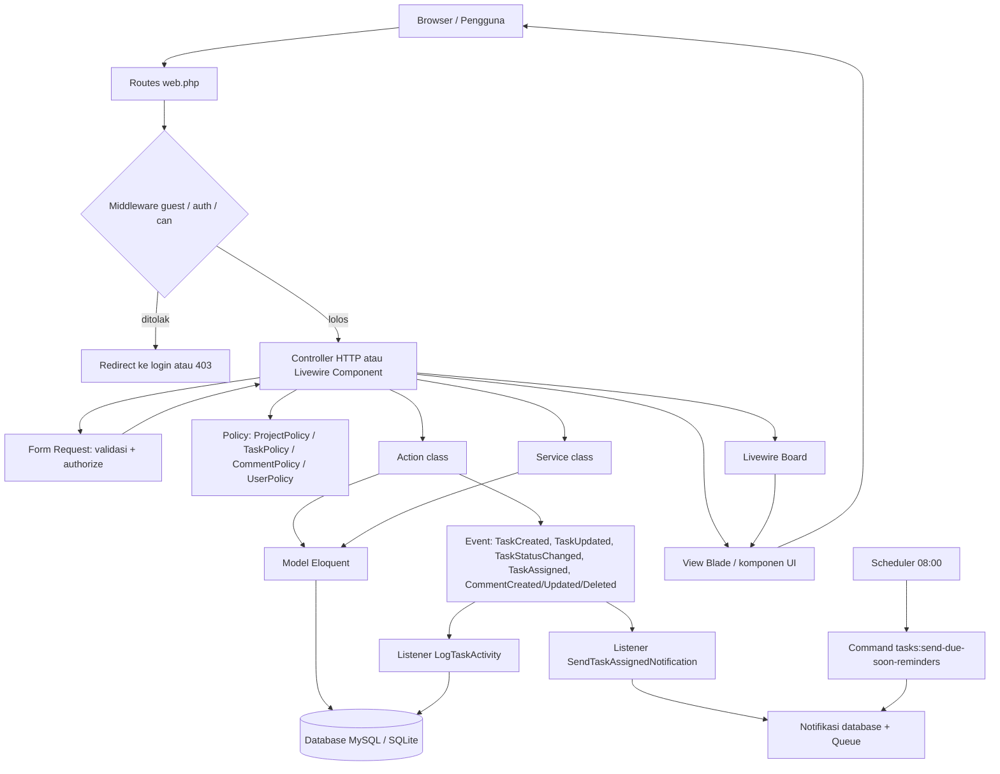

# 03 — Arsitektur Aplikasi dan Struktur Folder

## 3.1 Gambaran arsitektur

TaskFlow adalah aplikasi web monolitik Laravel yang mengikuti pola **MVC + Action/Service + Policy**. Sebagian besar halaman dirender di server (Blade), dengan satu pulau interaktif (Livewire) untuk papan Kanban.

Lapisan utama:

1. **Browser** — mengirim permintaan HTTP, menjalankan Alpine.js dan SortableJS.
2. **Routes** (`routes/web.php`) — memetakan URL ke controller atau komponen Livewire, dilindungi middleware `guest`/`auth` dan `can:...`.
3. **Middleware & Policy** — memeriksa login dan hak akses.
4. **Form Request** — memvalidasi dan mengotorisasi input.
5. **Controller / Livewire Component** — mengatur alur, memanggil Action/Service, mengembalikan view atau redirect.
6. **Action** — satu kelas untuk satu operasi bisnis (buat proyek, ubah status, tambah anggota, dst.).
7. **Service** — kueri lintas fitur dan perhitungan (dashboard, progres, filter daftar).
8. **Model Eloquent** — relasi, cast enum, scope, soft delete.
9. **Database** — MySQL saat pengembangan, SQLite in-memory saat pengujian.
10. **Event → Listener** — mencatat activity log dan mengirim notifikasi.
11. **View/Blade + komponen** — menghasilkan HTML.

## 3.2 Diagram arsitektur



## 3.3 Alur satu permintaan (contoh: mengubah status tugas)

1. Pengguna menekan tombol **Perbarui status** pada `resources/views/tasks/partials/status-form.blade.php`.
2. Form mengirim `PATCH /projects/{project}/tasks/{task}/status` dengan field `status`.
3. Route `projects.tasks.status` mengarah ke `TaskController@updateStatus`.
4. `UpdateTaskStatusRequest` memvalidasi `status` dengan `Rule::enum(TaskStatus::class)` dan memanggil `authorize()` → `TaskPolicy::updateStatus`.
5. Controller memanggil `UpdateTaskStatusAction::execute($task, $status, actor: $user)`.
6. Action membuka transaksi database, menghitung ulang posisi kolom asal/tujuan, mengisi atau mengosongkan `completed_at`, menyimpan tugas.
7. Jika status berubah, `TaskStatusChanged` di-dispatch.
8. `LogTaskActivity::handleTaskStatusChanged` menulis baris baru ke `activity_logs`.
9. Controller mengembalikan `back()` dengan flash `success`; `x-ui.flash` menampilkannya.

## 3.4 Struktur folder aktual

```
task-manager/
├─ app/
│  ├─ Actions/
│  │  ├─ Comments/  (CreateCommentAction, UpdateCommentAction, DeleteCommentAction)
│  │  ├─ Members/   (AddMemberAction, ChangeMemberRoleAction, RemoveMemberAction)
│  │  ├─ Projects/  (CreateProjectAction, UpdateProjectAction, DeleteProjectAction)
│  │  └─ Tasks/     (CreateTaskAction, UpdateTaskAction, UpdateTaskStatusAction,
│  │                 DeleteTaskAction, ReorderTasksAction)
│  ├─ Console/Commands/SendDueSoonTaskReminders.php
│  ├─ Enums/        (DashboardRole, ProjectRole, ProjectStatus, TaskPriority,
│  │                 TaskStatus, UserRole)
│  ├─ Events/       (TaskCreated, TaskUpdated, TaskStatusChanged, TaskAssigned,
│  │                 CommentCreated, CommentUpdated, CommentDeleted)
│  ├─ Http/
│  │  ├─ Controllers/ (AdminMemberController, CommentController,
│  │  │                 DashboardController, ProjectController,
│  │  │                 ProjectMemberController, TaskController,
│  │  │                 Auth/LoginController, Auth/RegisterController)
│  │  └─ Requests/    (Auth, Comment, Member, Project, Task, User)
│  ├─ Listeners/    (LogTaskActivity, SendTaskAssignedNotification)
│  ├─ Livewire/Tasks/Board.php
│  ├─ Models/       (ActivityLog, Comment, Project, ProjectMember, Task, User)
│  ├─ Notifications/ (TaskAssignedNotification, TaskDueSoonNotification)
│  ├─ Policies/     (CommentPolicy, ProjectPolicy, TaskPolicy, UserPolicy)
│  ├─ Providers/AppServiceProvider.php
│  └─ Services/     (DashboardService, ProjectProgressService,
│                    ProjectQueryService, TaskQueryService, UserQueryService)
├─ bootstrap/app.php, providers.php
├─ config/          (app, database, auth, queue, session, cache, mail, dll.)
├─ database/
│  ├─ factories/    (UserFactory, ProjectFactory, TaskFactory,
│  │                 CommentFactory, ActivityLogFactory)
│  ├─ migrations/   (10 migration)
│  └─ seeders/      (DatabaseSeeder, DemoDataSeeder)
├─ docs/            (dokumentasi ini + dokumen UI sebelumnya)
├─ lang/id/         (activity, admin_members, auth, comments, common,
│                    dashboard, members, notifications, projects, roles,
│                    tasks, validation)
├─ public/          (index.php, build/, images/taskflow-icon.svg, favicon.ico)
├─ resources/
│  ├─ css/app.css
│  ├─ js/app.js
│  └─ views/        (layouts, dashboard, projects, tasks, admin,
│                    livewire, components, auth, welcome)
├─ routes/web.php, routes/console.php
├─ storage/         (log, cache, framework/views)
├─ tests/
│  ├─ Feature/      (Admin, Auth, Comments, Dashboard, Database,
│  │                 Navigation, Notifications, Projects, Tasks)
│  ├─ Unit/ExampleTest.php
│  └─ TestCase.php
├─ composer.json, package.json, vite.config.js, phpunit.xml
├─ PRD (Task Management).md
├─ DESIGN_SYSTEM (Task Management).md
└─ AGENTS.md
```

## 3.5 Fungsi folder penting dan contoh nyata

### `app/Models`

Menyimpan model Eloquent beserta relasi, cast, dan scope.

- `Project.php` — relasi `owner`, `members` (belongsToMany dengan pivot `role`), `tasks`, `activityLogs`; scope `forUser`; helper `roleOf`, `isArchived`.
- `Task.php` — relasi `project`, `creator`, `assignee`, `comments`, `activityLogs`; scope `overdue`; helper `isCompleted`, `isOverdue`.
- `User.php` — relasi `ownedProjects`, `projects`, `createdTasks`, `assignedTasks`, `comments`, `activityLogs`; helper `isAdmin`.
- `ActivityLog.php` — cast `properties` ke array, label aksi/nilai lama-baru.

### `app/Http/Controllers`

Controller tipis; logika bisnis didelegasikan ke Action/Service.

- `ProjectController.php` — `index`, `create`, `store`, `show`, `edit`, `update`, `destroy`.
- `TaskController.php` — CRUD tugas, `board`, `updateStatus`, `reorder`.
- `CommentController.php` — `store`, `update`, `destroy`.
- `ProjectMemberController.php` — `store`, `update`, `destroy`.
- `AdminMemberController.php` — daftar dan detail anggota (khusus Admin).
- `Auth/LoginController.php` dan `Auth/RegisterController.php` — autentikasi.
- `DashboardController.php` — satu method `__invoke`.

### `app/Http/Requests`

Validasi sekaligus otorisasi awal:

- `Project/StoreProjectRequest.php`, `UpdateProjectRequest.php`, `IndexProjectRequest.php`
- `Task/StoreTaskRequest.php`, `UpdateTaskRequest.php`, `UpdateTaskStatusRequest.php`, `ReorderTaskRequest.php`, `IndexTaskRequest.php`
- `Member/StoreMemberRequest.php`, `UpdateMemberRequest.php`
- `Comment/StoreCommentRequest.php`, `UpdateCommentRequest.php`
- `Auth/LoginRequest.php`, `RegisterRequest.php`
- `User/IndexUserRequest.php`

### `app/Policies`

- `ProjectPolicy` — `viewAny`, `view`, `create`, `update`, `delete`, `manageMembers`, `changeMemberRole`, `removeMember`.
- `TaskPolicy` — `viewAny`, `view`, `create`, `update`, `updateStatus`, `delete`, `reorder`.
- `CommentPolicy` — `create`, `update`, `delete`.
- `UserPolicy` — `viewAny`, `view` (khusus Admin).

Policy ditemukan otomatis oleh Laravel berdasarkan nama model (`Project` → `ProjectPolicy`) di folder `app/Policies`.

### `app/Actions`

Satu kelas, satu operasi. Contoh:

- `CreateProjectAction` — membuat proyek sekaligus melampirkan pembuat sebagai Manager proyek dalam satu transaksi.
- `CreateTaskAction` — menghitung `position` di kolom Todo, menyimpan tugas, mengirim `TaskCreated` dan `TaskAssigned`.
- `UpdateTaskStatusAction` — satu-satunya jalur perubahan status; menjaga `completed_at` dan urutan.
- `RemoveMemberAction` — mengosongkan `assigned_to` tugas anggota tersebut lalu melepas pivot.

### `app/Services`

- `DashboardService` — memilih dashboard berdasarkan peran dan menyusun statistik.
- `ProjectProgressService` — persentase tugas selesai.
- `ProjectQueryService` — daftar proyek dengan filter/pagination dan daftar calon anggota.
- `TaskQueryService` — daftar tugas per proyek dengan filter, dikelompokkan per status.
- `UserQueryService` — daftar pengguna untuk halaman admin.

### `app/Livewire`

- `Tasks/Board.php` — komponen papan Kanban: filter, pindah tugas, otorisasi.

### `database/migrations`

Sepuluh migration: tabel bawaan Laravel (`users`, `password_reset_tokens`, `sessions`, `cache`, `cache_locks`, `jobs`, `job_batches`, `failed_jobs`) dan tabel aplikasi (`projects`, `project_user`, `tasks`, `comments`, `activity_logs`, `notifications`), plus penambahan `role` dan `avatar` pada `users`.

### `database/seeders`

- `DatabaseSeeder.php` memanggil `DemoDataSeeder`.
- `DemoDataSeeder.php` membuat 3 proyek (aktif, perencanaan, arsip), 7 pengguna demo, tugas, komentar, dan activity log. Akun demo antara lain `admin@taskmanager.test`, `rina@taskmanager.test`, `sari@taskmanager.test` (password ditentukan factory).

### `resources/views`

- `layouts/app.blade.php` — kerangka halaman setelah login (sidebar, topbar, flash, konten).
- `layouts/guest.blade.php` — kerangka login/registrasi dengan panel branding.
- `dashboard.blade.php` memilih partial `dashboard/{admin,manager,member}.blade.php` berdasarkan `$role`.
- `projects/` — daftar, detail (tab overview/anggota/aktivitas), form, create, edit.
- `tasks/` — daftar per status, papan, detail dengan komentar dan timeline, form tambah/edit.
- `admin/members/` — daftar anggota dan detail anggota.
- `livewire/tasks/board.blade.php` — tampilan papan Kanban.
- `components/` — komponen UI, dashboard, task, activity, layout, brand.

### `routes`

- `routes/web.php` — 32 route web (lihat `docs/04`).
- `routes/console.php` — pendaftaran scheduler `tasks:send-due-soon-reminders` setiap hari pukul 08:00.

### `public`

Titik masuk `public/index.php`, hasil build Vite di `public/build`, ikon `public/images/taskflow-icon.svg`, dan `favicon.ico`.

### `tests`

- `tests/Feature` — 21 berkas berisi tes alur nyata (auth, proyek, anggota, tugas, board, komentar, dashboard, aktivitas, notifikasi, admin, navigasi, enum, relasi, seeder).
- `tests/Unit/ExampleTest.php` — satu tes dasar.
- `tests/TestCase.php` — kelas dasar PHPUnit Laravel.

### `docs`

Berisi dokumentasi teknis ini serta dua dokumen sebelumnya: `admin-members-and-back-navigation.md` dan `ui-ux-branding.md`.

## 3.6 Prinsip desain kode yang terlihat

1. **Controller tipis.** Tidak ada logika bisnis berat di controller; semuanya di Action/Service.
2. **Satu Action untuk satu perubahan status.** Semua jalur (form, Livewire, reorder) memakai `UpdateTaskStatusAction`.
3. **Otorisasi berlapis.** Route (`can:`), Form Request (`authorize`), controller (`$this->authorize`), dan tampilan (`@can`) memakai Policy yang sama.
4. **Enum menggantikan string bebas.** Status, prioritas, peran, dan status proyek memakai enum PHP.
5. **Transaksi database** dipakai pada operasi yang menyentuh lebih dari satu baris (membuat proyek + pivot, memindahkan tugas + reorder, menghapus komentar + event).
6. **Event-driven side effect.** Activity log dan notifikasi tidak ditulis langsung di controller, melainkan lewat event/listener.
7. **Soft delete** pada `projects` dan `tasks` untuk menjaga riwayat.
