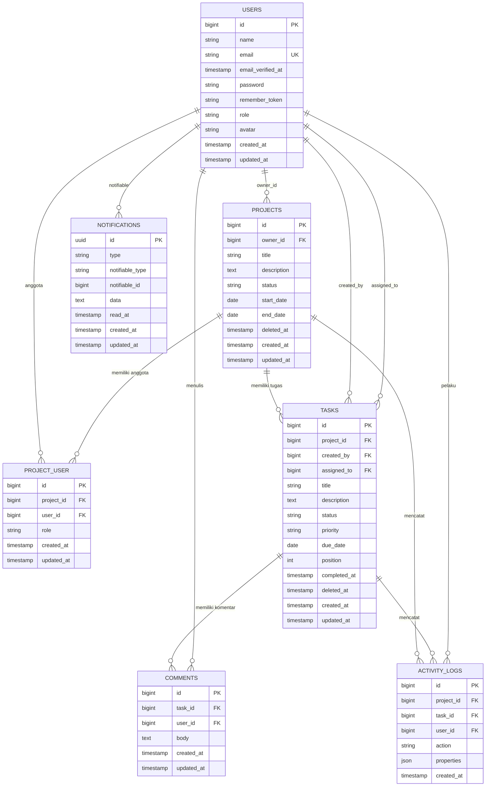

# 05 — Database dan ERD

Dokumen ini disusun dari 10 berkas migration di `database/migrations/` dan model Eloquent di `app/Models/`. Tidak ada tabel atau kolom yang ditambahkan di luar yang benar-benar ada.

## 5.1 Daftar tabel

| No | Tabel | Jenis | Sumber migration |
|---|---|---|---|
| 1 | `users` | Tabel aplikasi | `0001_01_01_000000_create_users_table.php`, `2026_10_31_000001_add_role_and_avatar_to_users_table.php` |
| 2 | `password_reset_tokens` | Bawaan Laravel (belum dipakai fitur) | `0001_01_01_000000_create_users_table.php` |
| 3 | `sessions` | Sesi database | `0001_01_01_000000_create_users_table.php` |
| 4 | `cache` | Cache database | `0001_01_01_000001_create_cache_table.php` |
| 5 | `cache_locks` | Lock cache | `0001_01_01_000001_create_cache_table.php` |
| 6 | `jobs` | Queue database | `0001_01_01_000002_create_jobs_table.php` |
| 7 | `job_batches` | Batch queue | `0001_01_01_000002_create_jobs_table.php` |
| 8 | `failed_jobs` | Job gagal | `0001_01_01_000002_create_jobs_table.php` |
| 9 | `projects` | Proyek | `2026_10_31_000002_create_projects_table.php` |
| 10 | `project_user` | Pivot anggota proyek | `2026_10_31_000003_create_project_user_table.php` |
| 11 | `tasks` | Tugas | `2026_10_31_000004_create_tasks_table.php` |
| 12 | `comments` | Komentar tugas | `2026_10_31_000005_create_comments_table.php` |
| 13 | `activity_logs` | Riwayat aktivitas | `2026_10_31_000006_create_activity_logs_table.php` |
| 14 | `notifications` | Notifikasi database | `2026_11_01_000001_create_notifications_table.php` |

## 5.2 Detail kolom tabel aplikasi

### `users`

| Kolom | Tipe | Aturan | Keterangan |
|---|---|---|---|
| `id` | bigint unsigned | PK, auto increment | |
| `name` | varchar(255) | wajib | Nama pengguna |
| `email` | varchar(255) | unik | Login |
| `email_verified_at` | timestamp | nullable | Tidak dipakai fitur verifikasi |
| `password` | varchar(255) | wajib | Hash (cast `hashed`) |
| `remember_token` | varchar(100) | nullable | Remember me |
| `role` | varchar(255) | default `member`, index | `admin` / `manager` / `member` |
| `avatar` | varchar(255) | nullable | Kolom tersedia, belum ada unggah/avatar kustom di UI |
| `created_at`, `updated_at` | timestamp | nullable | |

### `projects`

| Kolom | Tipe | Aturan | Keterangan |
|---|---|---|---|
| `id` | bigint unsigned | PK | |
| `owner_id` | bigint unsigned | FK `users.id`, `restrictOnDelete` | Pembuat/pemilik proyek |
| `title` | varchar(255) | wajib | |
| `description` | text | nullable | |
| `status` | varchar(255) | default `planning`, index | `planning`, `active`, `on_hold`, `completed`, `archived` |
| `start_date` | date | nullable | |
| `end_date` | date | nullable | |
| `deleted_at` | timestamp | nullable | Soft delete |
| `created_at`, `updated_at` | timestamp | nullable | |

### `project_user`

| Kolom | Tipe | Aturan | Keterangan |
|---|---|---|---|
| `id` | bigint unsigned | PK | |
| `project_id` | bigint unsigned | FK `projects.id`, cascade | |
| `user_id` | bigint unsigned | FK `users.id`, cascade, index | |
| `role` | varchar(255) | default `member` | `manager` / `member` |
| `created_at`, `updated_at` | timestamp | nullable | |

Batasan: `unique(project_id, user_id)` — satu pengguna hanya boleh muncul sekali per proyek.

### `tasks`

| Kolom | Tipe | Aturan | Keterangan |
|---|---|---|---|
| `id` | bigint unsigned | PK | |
| `project_id` | bigint unsigned | FK `projects.id`, cascade | |
| `created_by` | bigint unsigned | FK `users.id`, cascade | Pembuat tugas |
| `assigned_to` | bigint unsigned | FK `users.id`, nullable, `nullOnDelete`, index | Penanggung jawab |
| `title` | varchar(255) | wajib | |
| `description` | text | nullable | |
| `status` | varchar(255) | default `todo` | `todo`, `in_progress`, `in_review`, `completed` |
| `priority` | varchar(255) | default `medium` | `low`, `medium`, `high`, `urgent` |
| `due_date` | date | nullable, index | Tenggat |
| `position` | int unsigned | default 0 | Urutan dalam kolom status |
| `completed_at` | timestamp | nullable | Diisi saat status `completed` |
| `deleted_at` | timestamp | nullable | Soft delete |
| `created_at`, `updated_at` | timestamp | nullable | |

Index gabungan: `(project_id, status, position)`.

### `comments`

| Kolom | Tipe | Aturan |
|---|---|---|
| `id` | bigint unsigned | PK |
| `task_id` | bigint unsigned | FK `tasks.id`, cascade |
| `user_id` | bigint unsigned | FK `users.id`, cascade |
| `body` | text | wajib (validasi maks 2000 karakter) |
| `created_at`, `updated_at` | timestamp | nullable |

### `activity_logs`

| Kolom | Tipe | Aturan |
|---|---|---|
| `id` | bigint unsigned | PK |
| `project_id` | bigint unsigned | FK `projects.id`, cascade |
| `task_id` | bigint unsigned | FK `tasks.id`, nullable, `nullOnDelete` |
| `user_id` | bigint unsigned | FK `users.id`, nullable, `nullOnDelete` |
| `action` | varchar(255) | contoh `task.created`, `task.status_changed` |
| `properties` | json | nullable, cast array |
| `created_at` | timestamp | nullable |

Model `ActivityLog` menetapkan `const UPDATED_AT = null`, sehingga hanya `created_at` yang diisi. Index: `(project_id, created_at)`.

### `notifications`

| Kolom | Tipe | Aturan |
|---|---|---|
| `id` | uuid | PK |
| `type` | varchar(255) | Kelas notifikasi |
| `notifiable_type`, `notifiable_id` | varchar / bigint | Polymorphic (`morphs`) + index |
| `data` | text | Payload JSON |
| `read_at` | timestamp | nullable |
| `created_at`, `updated_at` | timestamp | nullable |

## 5.3 Relasi Eloquent aktual

| Model | Relasi | Tipe | Catatan |
|---|---|---|---|
| `User` | `ownedProjects()` | hasMany `Project` (FK `owner_id`) | Proyek yang dimiliki |
| `User` | `projects()` | belongsToMany `Project` via `project_user` | `withPivot('role')`, `withTimestamps`, memakai model pivot `ProjectMember` |
| `User` | `createdTasks()` | hasMany `Task` (FK `created_by`) | |
| `User` | `assignedTasks()` | hasMany `Task` (FK `assigned_to`) | |
| `User` | `comments()` | hasMany `Comment` | |
| `User` | `activityLogs()` | hasMany `ActivityLog` | |
| `Project` | `owner()` | belongsTo `User` (FK `owner_id`) | |
| `Project` | `members()` | belongsToMany `User` via `project_user` | `withPivot('role')` |
| `Project` | `tasks()` | hasMany `Task` | |
| `Project` | `activityLogs()` | hasMany `ActivityLog` | |
| `ProjectMember` | — | Pivot | `$table = 'project_user'`, cast `role` ke `ProjectRole` |
| `Task` | `project()` | belongsTo `Project` | |
| `Task` | `creator()` | belongsTo `User` (FK `created_by`) | |
| `Task` | `assignee()` | belongsTo `User` (FK `assigned_to`) | |
| `Task` | `comments()` | hasMany `Comment` | |
| `Task` | `activityLogs()` | hasMany `ActivityLog` | |
| `Comment` | `task()` | belongsTo `Task` | |
| `Comment` | `user()` | belongsTo `User` | |
| `ActivityLog` | `project()`, `task()`, `user()` | belongsTo | `task_id` dan `user_id` boleh null |

## 5.4 ERD

Catatan ERD:

- Relasi `USERS ||--o{ PROJECT_USER` dan `PROJECTS ||--o{ PROJECT_USER` adalah representasi pivot many-to-many.
- `NOTIFICATIONS` memakai relasi polymorphic; pada aplikasi ini satu-satunya `notifiable` adalah `App\Models\User`.
- `password_reset_tokens`, `sessions`, `cache`, `cache_locks`, `jobs`, `job_batches`, dan `failed_jobs` tidak digambarkan karena merupakan tabel infrastruktur Laravel, bukan entitas bisnis TaskFlow.

## 5.5 Tabel infrastruktur

| Tabel | Fungsi | Kolom penting |
|---|---|---|
| `password_reset_tokens` | Menyimpan token reset password (belum dipakai) | `email` (PK), `token`, `created_at` |
| `sessions` | Menyimpan sesi karena `SESSION_DRIVER=database` | `id` (PK), `user_id`, `ip_address`, `user_agent`, `payload`, `last_activity` |
| `cache` | Cache karena `CACHE_STORE=database` | `key` (PK), `value`, `expiration` |
| `cache_locks` | Lock cache | `key` (PK), `owner`, `expiration` |
| `jobs` | Antrean karena `QUEUE_CONNECTION=database` | `id`, `queue`, `payload`, `attempts`, `available_at` |
| `job_batches` | Batch job | `id` (PK), `name`, `total_jobs`, `pending_jobs`, `failed_jobs` |
| `failed_jobs` | Job gagal | `id`, `uuid` (unik), `connection`, `queue`, `payload`, `exception`, `failed_at` |

## 5.6 Perbedaan dengan draft PRD

PRD bagian 10 memuat draft model data. Implementasi aktual memiliki beberapa perbedaan yang perlu dicatat:

| Hal | PRD | Implementasi aktual |
|---|---|---|
| Reset password | Disebut sebagai fitur | Tabel `password_reset_tokens` ada, tetapi route/controller/view belum dibuat |
| Profil & avatar | `users.avatar` dan halaman profil | Kolom `avatar` ada dan masuk `$fillable`, tetapi belum ada unggah avatar atau halaman profil |
| Notifikasi | Email/notifikasi database | Hanya channel `database`; tidak ada email dan tidak ada UI notifikasi |
| Index `tasks` | `tasks(project_id, status)`, `tasks(assigned_to)`, `tasks(due_date)` | Index gabungan `(project_id, status, position)` + index terpisah `assigned_to` dan `due_date` |
| Hapus proyek | Soft delete | Soft delete, tetapi tugas tidak ikut terhapus; statistik harus memfilter `whereHas('project')` |
| Tabel `notifications` | Tidak dirinci | Ada, dibuat oleh migration `2026_11_01_000001` |
| Kolom `projects.owner_id` | FK | FK dengan `restrictOnDelete` (bukan cascade) |
| Kolom `tasks.position` | Disebut | Ada sebagai `unsignedInteger` default 0, dipakai untuk urutan Kanban |

## 5.7 Catatan integritas data

1. **Soft delete dan foreign key.** `projects` dan `tasks` memakai soft delete. Karena baris tidak benar-benar dihapus, foreign key `tasks.project_id` tetap valid, tetapi tugas dari proyek terhapus harus disaring secara eksplisit di kueri statistik.
2. **Penghapusan penanggung jawab.** FK `tasks.assigned_to` memakai `nullOnDelete`, dan `RemoveMemberAction` juga mengosongkan `assigned_to` secara eksplisit. Tes `ModelRelationsTest::test_removing_an_assignee_sets_the_task_assignee_to_null_through_the_foreign_key` memverifikasi perilaku ini.
3. **Keunikan anggota.** `unique(project_id, user_id)` mencegah penambahan anggota ganda; validasi `StoreMemberRequest` juga memeriksa hal yang sama.
4. **Enum disimpan sebagai string.** Nilai enum PHP (`App\Enums\*`) dipetakan ke string di kolom varchar, sehingga perubahan nilai enum harus disertai migrasi data bila diperlukan.
5. **Activity log tidak memiliki `updated_at`.** Model menetapkan `UPDATED_AT = null`; jangan mengandalkan `updated_at` pada tabel ini.
