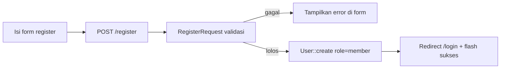
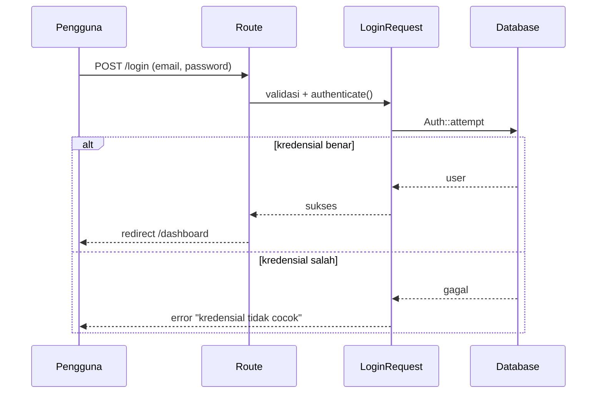
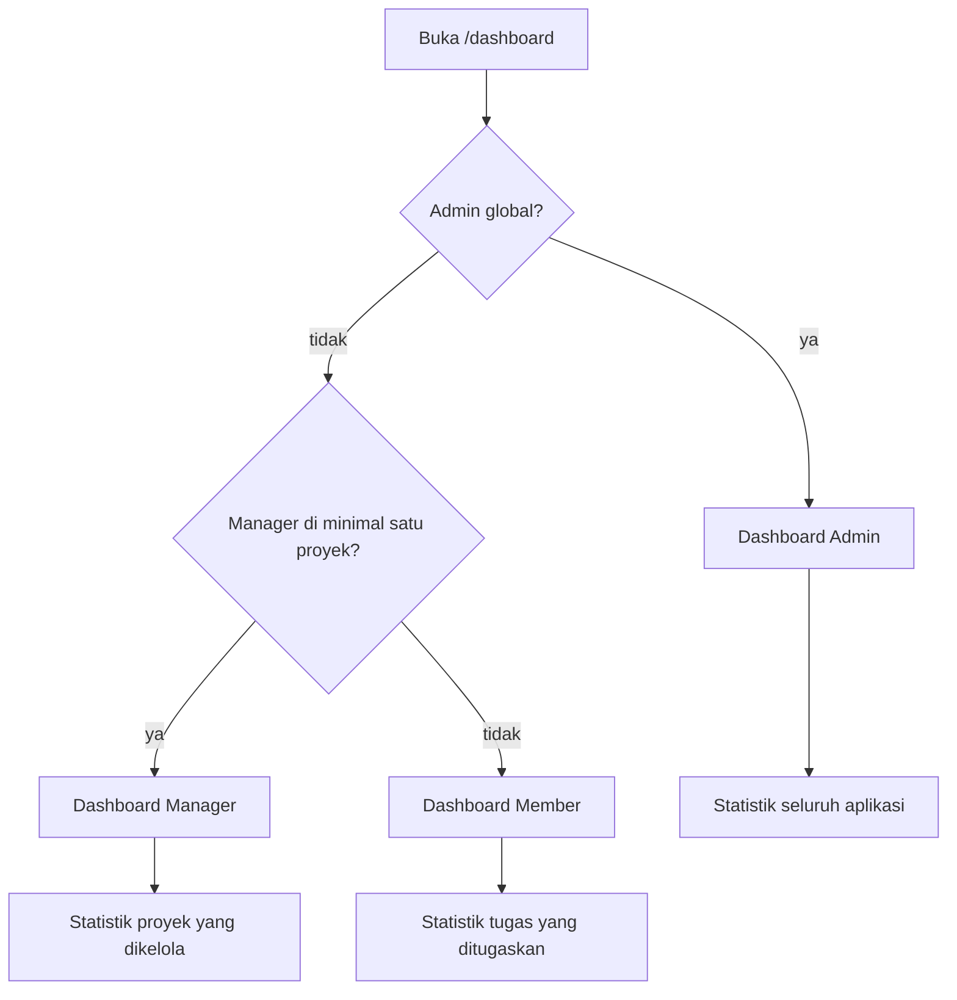
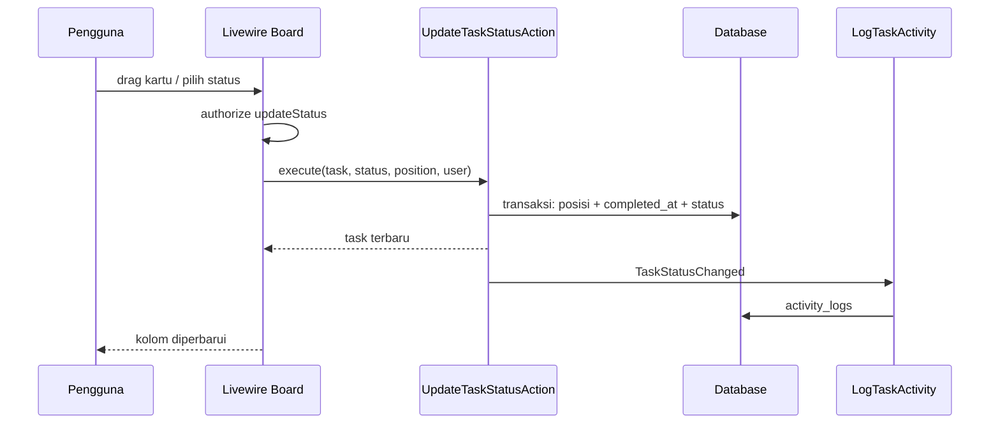
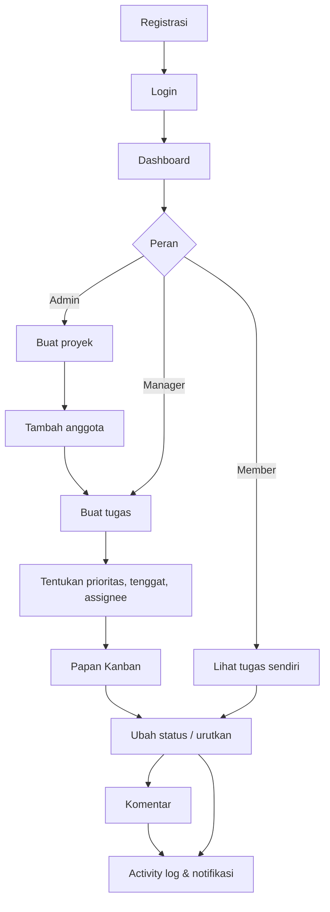

# 06 — Alur Kerja Sistem

Dokumen ini menjelaskan alur setiap fitur dari tindakan pengguna sampai hasil yang terlihat. Setiap bagian mencantumkan route, pemroses, validasi, model/tabel, dan hasil.

## 6.1 Register

**Tindakan pengguna:** membuka `/register`, mengisi nama, email, password, dan konfirmasi password, lalu menekan tombol daftar.

**Route:** `GET /register` (`register`) dan `POST /register`.

**Pemroses:** `App\Http\Controllers\Auth\RegisterController` (`create`, `store`) dengan `App\Http\Requests\Auth\RegisterRequest`.

**Validasi:**

- `name`: wajib, string, maks 255; di-`trim` sebelum validasi.
- `email`: wajib, format email, maks 255, unik di tabel `users`; di-`trim` dan di-lowercase.
- `password`: wajib, string, `confirmed`, minimal 8 karakter (`Password::min(8)`).

**Model dan tabel:** `User`, tabel `users`.

**Proses:**

1. `RegisterRequest::prepareForValidation()` menormalkan nama dan email.
2. `RegisterController@store` membuat user dengan `role => UserRole::Member`. Field `role` dari input tidak dipakai.
3. Password di-hash otomatis melalui cast `'password' => 'hashed'`.
4. Redirect ke `login` dengan flash `auth.registered`.

**Hasil:** halaman login dengan pesan sukses. Pengguna belum otomatis login.

## 6.2 Login dan logout

**Login — tindakan:** mengisi email dan password di `/login`, opsional mencentang "Ingat saya".

**Route:** `GET /login` (`login`), `POST /login`.

**Pemroses:** `Auth\LoginController@store` dengan `Auth\LoginRequest`.

**Validasi:** `email` wajib dan format email; `password` wajib. Rate limit: maksimal 5 percobaan per kombinasi email+IP; melebihi batas memicu `Lockout` dan pesan `auth.throttle`.

**Model dan tabel:** `User`, `users`, `sessions`.

**Proses:** `Auth::attempt` → regenerasi sesi → `redirect()->intended(route('dashboard'))` dengan flash `auth.logged_in`. Jika gagal, `ValidationException` pada field `email` dengan pesan `auth.failed`.

**Logout — tindakan:** menekan tombol keluar di sidebar atau menu topbar.

**Route:** `POST /logout` (`logout`), dilindungi middleware `auth`.

**Proses:** `auth()->guard('web')->logout()`, invalidasi sesi, regenerasi token CSRF, redirect ke `login` dengan flash `auth.logged_out`.

## 6.3 Lupa password dan reset password

**Status: belum tersedia.**

Tidak ada route `password.request`, `password.email`, `password.reset`, atau tampilan terkait di `routes/web.php` dan `resources/views`. Tabel `password_reset_tokens` hanya dibuat oleh migration bawaan Laravel dan belum dipakai. Karena itu alur ini tidak dapat didokumentasikan sebagai fitur yang berjalan.

## 6.4 Dashboard

**Tindakan pengguna:** membuka `/dashboard` setelah login.

**Route:** `GET /dashboard` (`dashboard`).

**Pemroses:** `DashboardController` (`__invoke`) → `DashboardService::dashboardFor()`.

**Validasi/otorisasi:** middleware `auth`. Tidak ada Form Request karena hanya membaca data.

**Model dan tabel:** `User`, `Project`, `Task`, `ActivityLog`, tabel `projects`, `project_user`, `tasks`, `activity_logs`.

**Proses:**

1. `DashboardService::roleFor()` menentukan peran tampilan:
   - Admin global → dashboard Admin;
   - user yang menjadi Manager di minimal satu proyek → dashboard Manager;
   - selain itu → dashboard Member.
2. Service menyusun statistik dan daftar sesuai peran.
3. `dashboard.blade.php` meng-include `dashboard/{role}.blade.php`.

**Hasil per peran:**

- **Admin:** total proyek, total pengguna, proyek aktif, proyek selesai, total tugas, tugas overdue, ringkasan status tugas, proyek terbaru, proyek berjalan, dan 12 aktivitas terbaru.
- **Manager:** jumlah proyek yang dikelola, statistik tugas pada proyek tersebut, proyek yang dikelola, tugas terbaru, tugas jatuh tempo ≤ 7 hari, anggota tim, dan 10 aktivitas.
- **Member:** jumlah tugas yang ditugaskan, todo, dikerjakan, ditinjau, selesai, tugas overdue, daftar **Tugas Saya**, tugas jatuh tempo, tugas terlambat, proyek terbaru, dan aktivitas dari proyek yang diikuti. Service juga menghitung `completed_this_week` (tugas selesai minggu ini), tetapi nilainya belum ditampilkan pada strip statistik.

## 6.5 Membuat proyek

**Tindakan pengguna:** dari halaman daftar proyek, menekan **Proyek Baru**, mengisi judul, status, tanggal mulai/selesai (opsional), deskripsi (opsional), lalu menyimpan.

**Route:** `GET /projects/create` (`projects.create`), `POST /projects` (`projects.store`).

**Pemroses:** `ProjectController@create/store` → `StoreProjectRequest` → `ProjectPolicy::create` → `CreateProjectAction`.

**Validasi:**

- `title` wajib, maks 255.
- `description` opsional, maks 5000.
- `status` wajib dan harus salah satu `ProjectStatus`.
- `start_date` opsional, tanggal valid.
- `end_date` opsional, tanggal valid dan `after_or_equal:start_date`.

**Otorisasi:** hanya Admin (`ProjectPolicy::create`). Tombol "Proyek Baru" disembunyikan dengan `@can('create', App\Models\Project::class)`.

**Model dan tabel:** `Project`, `ProjectMember`, tabel `projects`, `project_user`.

**Proses:** `CreateProjectAction` dalam transaksi membuat proyek dengan `owner_id` = user yang login, lalu melampirkan user tersebut ke `project_user` dengan peran `manager`.

**Hasil:** redirect ke `projects.show` dengan flash `projects.created`. Proyek langsung muncul di daftar proyek pengguna.

## 6.6 Mengelola anggota proyek

**Tindakan pengguna:** membuka detail proyek → tab **Anggota** → memilih pengguna dan menekan **Tambah**, mengubah peran lewat dropdown, atau mengeluarkan anggota lewat dialog konfirmasi.

**Route:**

- `POST /projects/{project}/members` (`projects.members.store`)
- `PATCH /projects/{project}/members/{member}` (`projects.members.update`)
- `DELETE /projects/{project}/members/{member}` (`projects.members.destroy`)

**Pemroses:** `ProjectMemberController` dengan `StoreMemberRequest` / `UpdateMemberRequest`, Policy `manageMembers` / `changeMemberRole` / `removeMember`, dan Action `AddMemberAction` / `ChangeMemberRoleAction` / `RemoveMemberAction`.

**Validasi:**

- `user_id` wajib, integer, ada di `users`, dan belum terdaftar di proyek (`unique` pada `project_user` dengan `project_id`).
- `role` wajib dan harus `manager` atau `member`.

**Otorisasi:**

- Tambah/ubah/keluarkan anggota: Admin atau Manager proyek, dan proyek tidak berstatus `archived`.
- Ubah peran dan keluarkan hanya untuk anggota dengan peran pivot `member`. Manager proyek tidak dapat diturunkan atau dikeluarkan.

**Model dan tabel:** `Project`, `User`, `ProjectMember`, tabel `project_user`, `tasks` (saat mengeluarkan anggota).

**Hasil:**

- Anggota baru ditambahkan dengan peran `member` dan muncul di tab anggota.
- Perubahan peran langsung terlihat.
- Saat anggota dikeluarkan, semua tugas yang ditugaskan kepadanya di proyek itu menjadi tanpa penanggung jawab (`assigned_to = null`).

## 6.7 Membuat dan mengubah tugas

**Tindakan pengguna:** dari daftar tugas atau papan Kanban, menekan **Tugas Baru**, mengisi judul, prioritas, tenggat (opsional), penanggung jawab (opsional), deskripsi (opsional), lalu menyimpan. Untuk mengubah, menekan **Edit** pada tugas.

**Route:** `projects.tasks.create`, `projects.tasks.store`, `projects.tasks.edit`, `projects.tasks.update`.

**Pemroses:** `TaskController` dengan `StoreTaskRequest` / `UpdateTaskRequest`, Policy `TaskPolicy::create/update`, Action `CreateTaskAction` / `UpdateTaskAction`.

**Validasi create:**

- `title` wajib, maks 255.
- `description` opsional, maks 5000.
- `priority` wajib, enum `TaskPriority`.
- `due_date` opsional, tanggal valid, tidak boleh sebelum hari ini (`after_or_equal:today`).
- `assigned_to` opsional, integer, harus anggota proyek (`exists` pada `project_user` dengan `project_id`).

**Validasi update:** sama, tetapi `due_date` hanya `nullable|date` agar tanggal lama tetap dapat dipertahankan.

**Otorisasi:** Admin atau Manager proyek, dan proyek tidak arsip.

**Model dan tabel:** `Task`, `Project`, `User`, tabel `tasks`, `project_user`.

**Proses create:** `CreateTaskAction` menghitung `max(position)` pada kolom `todo`, membuat tugas dengan status `todo` dan posisi berikutnya, lalu mengirim `TaskCreated`. Jika ada penanggung jawab, `TaskAssigned` dikirim.

**Proses update:** `UpdateTaskAction` membandingkan nilai lama dan baru. Perubahan penanggung jawab → `TaskAssigned`. Perubahan prioritas → `TaskUpdated` field `priority`. Perubahan tenggat → `TaskUpdated` field `due_date`. Status tidak diubah lewat form ini.

**Hasil:** redirect ke halaman detail tugas dengan flash sukses; perubahan langsung tercermin di daftar, board, dashboard, dan activity log.

## 6.8 Menentukan penanggung jawab dan tenggat

**Penanggung jawab:**

- Dipilih dari anggota proyek pada form tugas (`assigned_to`).
- Divalidasi harus ada di `project_user` proyek tersebut.
- Perubahan penanggung jawab mencatat aktivitas `task.assigned` dan mengirim notifikasi database ke penanggung jawab baru (jika ada). Pelepasan penanggung jawab tidak mengirim notifikasi (`SendTaskAssignedNotification` hanya memanggil `notify` bila `newAssignee` tidak null).

**Tenggat:**

- Kolom `due_date` bertipe `date`, di-cast ke objek tanggal.
- Form memakai `<input type="date">`; nilai awal diambil dari `old('due_date', $task->due_date?->format('Y-m-d'))`.
- Saat membuat tugas, `min` diisi tanggal hari ini sehingga date picker tidak menawarkan tanggal lampau. Saat edit, `min` tidak dipasang agar tanggal lama tetap bisa disimpan.
- Tenggat boleh dikosongkan; nilai kosong disimpan sebagai `NULL`.
- Tugas dianggap overdue bila `due_date < today()` dan status bukan `completed` (`Task::scopeOverdue` dan `isOverdue()`).

## 6.9 Mengubah status melalui Kanban Board

**Tindakan pengguna:** membuka `/projects/{project}/board`, lalu menyeret kartu ke kolom lain atau memilih status dari dropdown pada kartu.

**Route halaman:** `GET /projects/{project}/board` (`projects.tasks.board`).

**Pemroses:** `TaskController@board` → komponen `App\Livewire\Tasks\Board` → `UpdateTaskStatusAction`.

**Validasi:**

- `status` wajib dan harus enum `TaskStatus`.
- `position` wajib integer minimal 0 (untuk drag-and-drop).
- Tugas harus milik proyek (`$this->project->tasks()->findOrFail($taskId)`).
- Otorisasi `TaskPolicy::updateStatus`:
  - Admin: selalu boleh (kecuali proyek arsip);
  - Manager proyek: boleh;
  - Member: hanya tugas yang `assigned_to` dirinya;
  - proyek arsip: tidak ada yang boleh, termasuk Admin.

**Model dan tabel:** `Task`, `Project`, tabel `tasks`, `activity_logs`.

**Proses `UpdateTaskStatusAction`:**

1. Simpan status sebelumnya.
2. Dalam transaksi, hitung `completed_at`: diisi `now()` bila status `completed`, dikosongkan bila bukan.
3. Rapikan posisi kolom asal dan kolom tujuan.
4. Simpan status, `completed_at`, dan `position`.
5. Jika status berubah, kirim `TaskStatusChanged`; listener menulis activity log dengan nilai lama dan baru.

**Hasil:** kartu berpindah kolom, urutan diperbarui, `completed_at` konsisten, dan activity log bertambah tanpa memuat ulang halaman penuh (Livewire).

## 6.10 Memberikan komentar

**Tindakan pengguna:** membuka detail tugas, menulis komentar pada form **Tambah komentar**, lalu menyimpan. Komentar dapat diedit atau dihapus oleh penulis atau Admin.

**Route:**

- `POST /projects/{project}/tasks/{task}/comments` (`projects.tasks.comments.store`)
- `PATCH /projects/{project}/tasks/{task}/comments/{comment}` (`projects.tasks.comments.update`)
- `DELETE /projects/{project}/tasks/{task}/comments/{comment}` (`projects.tasks.comments.destroy`)

**Pemroses:** `CommentController` → `StoreCommentRequest` / `UpdateCommentRequest` → `CommentPolicy` → Action komentar.

**Validasi:** `body` wajib, string, maks 2000 karakter.

**Otorisasi:**

- Tambah: Admin atau anggota proyek, proyek tidak arsip.
- Ubah/hapus: Admin atau penulis komentar, proyek tidak arsip.

**Model dan tabel:** `Comment`, `Task`, `User`, tabel `comments`, `activity_logs`.

**Proses:** Action membungkus perubahan dalam transaksi, lalu mengirim event `CommentCreated` / `CommentUpdated` / `CommentDeleted`. Listener `LogTaskActivity` menulis aktivitas `comment.created`, `comment.updated`, atau `comment.deleted`.

**Hasil:** komentar muncul di detail tugas (urut dari terlama), jumlah komentar diperbarui, dan timeline aktivitas bertambah. Tidak ada halaman komentar terpisah.

## 6.11 Melihat aktivitas

**Tindakan pengguna:** membuka detail tugas, detail proyek (tab **Aktivitas**), atau melihat panel aktivitas di dashboard.

**Route:** tidak ada route khusus; data dimuat oleh `TaskController@show`, `ProjectController@show`, dan `DashboardService`.

**Pemroses:** model `ActivityLog`, komponen `resources/views/components/activity/timeline.blade.php`.

**Model dan tabel:** `ActivityLog`, tabel `activity_logs`.

**Isi yang ditampilkan:** nama pelaku, aksi (misalnya "membuat tugas", "mengubah status"), judul tugas, nilai lama → nilai baru, dan waktu. Untuk komentar, ditampilkan kutipan isi.

**Batas data:** detail tugas dan proyek memuat maksimal 30 log terbaru; dashboard memuat 10–12 log terbaru.

## 6.12 Mengelola profil

**Status: belum tersedia.**

Tidak ada route profil, controller, form, atau view untuk mengubah nama, email, password, atau avatar. Halaman yang paling mendekati adalah detail anggota di panel admin (`admin.members.show`), tetapi hanya menampilkan data dan tidak dapat mengubahnya.

## 6.13 Ringkasan alur utama

