# 10 — Proses Pengembangan TaskFlow

Dokumen ini menjelaskan tahapan pengembangan dari persiapan lingkungan sampai aplikasi dapat dijalankan, berdasarkan struktur proyek, riwayat commit, dan konfigurasi yang ada.

## 10.1 Ringkasan tahapan

```mermaid
flowchart LR
    A[Persiapan lingkungan] --> B[Konfigurasi database]
    B --> C[Migration + Enum + Model + Factory + Seeder]
    C --> D[Autentikasi]
    D --> E[Proyek dan anggota]
    E --> F[Tugas, status, dan Kanban]
    F --> G[Dashboard per peran]
    G --> H[Activity log, komentar, notifikasi]
    H --> I[Antarmuka dan branding]
    I --> J[Pengujian dan perbaikan]
    J --> K[Git checkpoint]
```



## 10.2 Persiapan lingkungan Laravel

1. **Laragon** dipasang di Windows untuk menyediakan PHP 8.3+, MySQL, Apache/Nginx, dan virtual host.
2. Proyek Laravel dibuat di `C:\laragon\www\task-manager` (terlihat dari `APP_URL=http://task-manager.test`).
3. Dependensi PHP dipasang dengan `composer install`.
4. Dependensi frontend dipasang dengan `npm install`.
5. Berkas `.env` disalin dari `.env.example` lalu disesuaikan.
6. Kunci aplikasi dibuat dengan `php artisan key:generate`.
7. Aset dibangun dengan `npm run build` atau dijalankan dalam mode pengembangan dengan `npm run dev`.

Konfigurasi penting pada `.env` pengembangan:

```env
APP_ENV=local
APP_URL=http://task-manager.test
APP_LOCALE=id

DB_CONNECTION=mysql
DB_HOST=127.0.0.1
DB_PORT=3306
DB_DATABASE=task_manager
DB_USERNAME=root
DB_PASSWORD=

SESSION_DRIVER=database
QUEUE_CONNECTION=database
CACHE_STORE=database
MAIL_MAILER=log
```

Zona waktu `Asia/Jakarta` dan locale `id` diatur di `config/app.php`; `AppServiceProvider` memanggil `Carbon::setLocale(config('app.locale'))` agar nama bulan/hari mengikuti bahasa Indonesia.

## 10.3 Konfigurasi database

1. Database `task_manager` dibuat di MySQL Laragon.
2. Migration dijalankan:

   ```bash
   php artisan migrate
   ```

3. Untuk data demo:

   ```bash
   php artisan migrate:fresh --seed
   ```

   `DatabaseSeeder` memanggil `DemoDataSeeder`, yang membuat 7 pengguna demo, 3 proyek (aktif, perencanaan, arsip), tugas dengan berbagai status/prioritas/tenggat, komentar, dan activity log.

4. Untuk pengujian, `phpunit.xml` memakai SQLite in-memory sehingga tidak mengganggu database pengembangan.

## 10.4 Pembuatan migration, enum, model, factory, dan seeder

Urutan migration mencerminkan ketergantungan tabel:

1. `0001_01_01_000000_create_users_table.php` — `users`, `password_reset_tokens`, `sessions`.
2. `0001_01_01_000001_create_cache_table.php` — `cache`, `cache_locks`.
3. `0001_01_01_000002_create_jobs_table.php` — `jobs`, `job_batches`, `failed_jobs`.
4. `2026_10_31_000001_add_role_and_avatar_to_users_table.php` — menambah `role` (default `member`, index) dan `avatar`.
5. `2026_10_31_000002_create_projects_table.php` — `projects` dengan `owner_id`, status, tanggal, soft delete.
6. `2026_10_31_000003_create_project_user_table.php` — pivot dengan peran dan unique `(project_id, user_id)`.
7. `2026_10_31_000004_create_tasks_table.php` — `tasks` dengan status, prioritas, tenggat, posisi, `completed_at`, soft delete.
8. `2026_10_31_000005_create_comments_table.php` — komentar per tugas.
9. `2026_10_31_000006_create_activity_logs_table.php` — log aktivitas dengan `properties` JSON.
10. `2026_11_01_000001_create_notifications_table.php` — notifikasi database.

Setelah migration, dibuat:

- **Enum** di `app/Enums`: `UserRole`, `ProjectRole`, `ProjectStatus`, `TaskStatus`, `TaskPriority`, `DashboardRole`.
- **Model** di `app/Models`: `User`, `Project`, `ProjectMember` (pivot), `Task`, `Comment`, `ActivityLog`, beserta relasi, cast, dan scope.
- **Factory** di `database/factories`: `UserFactory`, `ProjectFactory`, `TaskFactory`, `CommentFactory`, `ActivityLogFactory`.
- **Seeder** di `database/seeders`: `DatabaseSeeder`, `DemoDataSeeder`.

Pendekatan enum dipilih agar nilai status/prioritas/peran tidak salah ketik dan dapat dipakai bersama oleh validasi, tampilan, dan query.

## 10.5 Pengembangan autentikasi

Autentikasi ditulis manual, bukan memakai starter kit:

1. Route `guest` untuk `login` dan `register`; route `auth` untuk `logout`.
2. `LoginRequest` menangani validasi, `Auth::attempt`, rate limit, dan pesan error.
3. `RegisterRequest` menormalkan input dan memvalidasi email unik serta password minimal 8 karakter.
4. `LoginController` dan `RegisterController` mengatur redirect dan flash message.
5. Tampilan memakai `layouts/guest.blade.php` dengan panel branding dan komponen input yang sama seperti form aplikasi.

Registrasi selalu menghasilkan role `member`. Ini diuji secara khusus agar input `role` dari pengguna tidak dapat menaikkan hak akses.

## 10.6 Pembuatan fitur proyek dan anggota

1. Migration `projects` dan `project_user`.
2. Policy `ProjectPolicy` untuk view/create/update/delete/manageMembers.
3. Action proyek: `CreateProjectAction` (proyek + pivot manager), `UpdateProjectAction`, `DeleteProjectAction` (soft delete).
4. Form Request untuk daftar, create, dan update proyek.
5. `ProjectQueryService` untuk daftar proyek dengan filter, pencarian, dan pagination.
6. `ProjectProgressService` untuk persentase progres.
7. Action anggota: `AddMemberAction`, `ChangeMemberRoleAction`, `RemoveMemberAction`.
8. Tampilan daftar proyek, detail proyek dengan tab, dan form proyek.

Keputusan penting: penghapusan proyek hanya soft delete dan tidak menghapus tugas. Karena itu, statistik Admin kemudian difilter dengan `whereHas('project')` agar tugas dari proyek terhapus tidak ikut terhitung.

## 10.7 Pembuatan fitur tugas, status, dan Kanban

1. Migration `tasks` dengan index `(project_id, status, position)`.
2. Enum `TaskStatus` dan `TaskPriority`.
3. Action `CreateTaskAction`, `UpdateTaskAction`, `DeleteTaskAction`, `UpdateTaskStatusAction`, `ReorderTasksAction`.
4. Form Request `StoreTaskRequest`, `UpdateTaskRequest`, `UpdateTaskStatusRequest`, `ReorderTaskRequest`, `IndexTaskRequest`.
5. `TaskQueryService` untuk daftar dan filter tugas.
6. Policy `TaskPolicy`, termasuk aturan khusus: Member hanya boleh mengubah status tugas yang ditugaskan kepadanya.
7. Halaman daftar tugas, form tambah/edit, detail tugas, dan papan Kanban.
8. Komponen Livewire `Tasks\Board` dan integrasi SortableJS melalui `Alpine.data('kanbanColumn')`.

Semua perubahan status diarahkan ke `UpdateTaskStatusAction` agar `completed_at` dan urutan kolom konsisten, baik dari form, dropdown, maupun drag-and-drop.

## 10.8 Pembuatan dashboard

1. `DashboardRole` enum untuk tiga varian tampilan.
2. `DashboardService::roleFor()` menentukan peran berdasarkan Admin global atau pivot manager.
3. Statistik dihitung dengan agregasi SQL (`count`, `sum(case when ...)`) agar tidak menarik semua baris ke PHP.
4. Query memakai eager loading (`with`, `withCount`) untuk menghindari N+1.
5. Tiga partial Blade: `dashboard/admin.blade.php`, `manager.blade.php`, `member.blade.php`, dengan komponen panel dan kartu yang sama.

Perbaikan yang tercatat: statistik Admin sempat menghitung tugas dari proyek yang sudah di-soft-delete. Perbaikan dilakukan dengan menambahkan `Task::query()->whereHas('project')` dan diuji lewat `DashboardStatsTest`.

## 10.9 Activity log, komentar, dan notifikasi

1. Event dibuat untuk perubahan tugas dan komentar.
2. `LogTaskActivity` menulis activity log dengan `properties` berisi judul, field, nilai lama, nilai baru, atau kutipan komentar.
3. `CommentPolicy` dan Action komentar ditambahkan, termasuk penolakan pada proyek arsip.
4. `TaskAssigned` memicu `SendTaskAssignedNotification` (queued, channel `database`).
5. `SendDueSoonTaskReminders` dijadwalkan setiap hari pukul 08:00 di `routes/console.php`.
6. Timeline aktivitas dipasang di detail tugas, detail proyek, dan dashboard.

## 10.10 Pengembangan antarmuka

1. `DESIGN_SYSTEM (Task Management).md` menjadi acuan token warna, tipografi, radius, dan kepadatan.
2. Tailwind v4 dipakai dengan token CSS (`--canvas`, `--surface`, `--line`, `--content`, `--brand`, `--status-*`, `--priority-*`).
3. Komponen UI dibuat sekali dan dipakai ulang: input, select, textarea, button, badge, avatar, avatar-stack, progress-bar, modal, confirm-dialog, empty-state, flash, back-button, form-field.
4. Layout aplikasi memakai sidebar tetap + topbar; layout tamu memakai panel branding.
5. Alpine.js menangani sidebar, tema, dropdown, tab, modal, dan konfirmasi.
6. Tema gelap ditambahkan dengan kelas `.dark` dan preferensi `localStorage`.
7. Branding TaskFlow diterapkan pada logo, favicon, judul halaman, dan teks terjemahan.
8. Navigasi kembali kontekstual ditambahkan lewat `x-ui.back-button` dengan fallback per halaman.

Contoh perbaikan yang terdokumentasi: kolom **Tenggat** pada form tugas sempat tidak tampil karena direktif `@if` berada di dalam tag komponen `<x-ui.input>`, sehingga Blade tidak meng-compile komponen dan menyisakan tag mentah. Perbaikan: memindahkan kondisi ke atribut `:min="$task->exists ? null : today()->toDateString()"` dan menambahkan `min-w-0` pada komponen input. Perbaikan ini diuji oleh `TaskDueDateFormTest` (6 tes).

## 10.11 Pengujian

1. Tes ditulis dengan PHPUnit 12.5 dan `RefreshDatabase`.
2. Setiap fitur utama memiliki tes Feature: autentikasi, proyek, anggota, tugas, board, komentar, dashboard, aktivitas, notifikasi, admin, navigasi, enum, relasi, dan seeder.
3. Database tes memakai SQLite in-memory.
4. Pemeriksaan format memakai `vendor/bin/pint`.
5. Hasil terakhir: **129 tes, 619 assertion, semua lulus**.

Alur kerja yang dipakai:

```bash
vendor/bin/pint
php artisan test
php artisan test --filter=NamaTest
```

## 10.12 Penggunaan Git dan GitHub

- Repositori diinisialisasi dengan branch `main`.
- Remote: `https://github.com/KhoirunnisaM/task-management.git`.
- Commit checkpoint yang ada:

  ```
  b522c62 chore: checkpoint progress task final
  3c8217c chore: checkpoint progress task 7
  f6f39e3 chore: checkpoint progress task 5
  ```

- Perubahan dicatat dalam commit terpisah agar riwayat pekerjaan terlihat.
- Tidak ada pipeline CI/CD di repositori; pengujian dijalankan secara lokal.
- Berkas yang tidak perlu masuk repositori diatur lewat `.gitignore` (misalnya `vendor/`, `node_modules/`, `.env`, `storage/*.key`).

## 10.13 Menjalankan aplikasi dari nol

```bash
# 1. Dependensi
composer install
npm install

# 2. Konfigurasi
copy .env.example .env        # Windows
php artisan key:generate

# 3. Sesuaikan .env
#    DB_CONNECTION=mysql, DB_DATABASE=task_manager, dst.

# 4. Database dan data demo
php artisan migrate:fresh --seed

# 5. Aset
npm run build                 # produksi
# atau: npm run dev           # pengembangan

# 6. Jalankan
php artisan serve             # atau akses http://task-manager.test via Laragon
```

Untuk fitur notifikasi queued dan pengingat harian:

```bash
php artisan queue:work
php artisan schedule:work
```

Akun demo dari `DemoDataSeeder` antara lain:

| Email | Peran global |
|---|---|
| `admin@taskmanager.test` | Admin |
| `rina@taskmanager.test` | Manager |
| `dedi@taskmanager.test` | Manager |
| `sari@taskmanager.test` | Member |
| `budi@taskmanager.test` | Member |
| `nadia@taskmanager.test` | Member |
| `fajar@taskmanager.test` | Member |

Semua akun demo memakai password yang sama dari `UserFactory`, yaitu **`password`** (`Hash::make('password')`).

## 10.14 Peran tools selama pengembangan

| Tool | Peran nyata |
|---|---|
| Laragon | Server lokal (PHP, MySQL, virtual host) |
| Composer | Memasang dan memperbarui paket PHP |
| NPM | Memasang dan menjalankan build frontend |
| Vite | Mengompilasi CSS/JS |
| Laravel | Kerangka aplikasi dan seluruh lapisan backend |
| Livewire | Komponen papan Kanban |
| Alpine.js + SortableJS | Interaksi dan drag-and-drop |
| Tailwind CSS | Styling berbasis token |
| PHPUnit | Menjalankan tes otomatis |
| Pint | Merapikan gaya kode |
| Git + GitHub | Menyimpan riwayat dan repositori daring |
| Visual Studio Code | Editor kode |
| OpenCode | Pemeriksaan kode, menjalankan tes, dan penyusunan dokumentasi |

## 10.15 Catatan pengembangan lanjutan

Fitur yang direncanakan tetapi belum dikerjakan (lihat juga `docs/01` dan `docs/06`):

- lupa/reset password;
- halaman profil dan ubah password;
- pusat notifikasi di antarmuka;
- notifikasi email;
- pengaturan aplikasi;
- CI/CD dan pengujian browser end-to-end.

Jika fitur-fitur tersebut ditambahkan, dokumentasi ini perlu diperbarui pada bagian route, hak akses, tampilan, dan pengujian.
